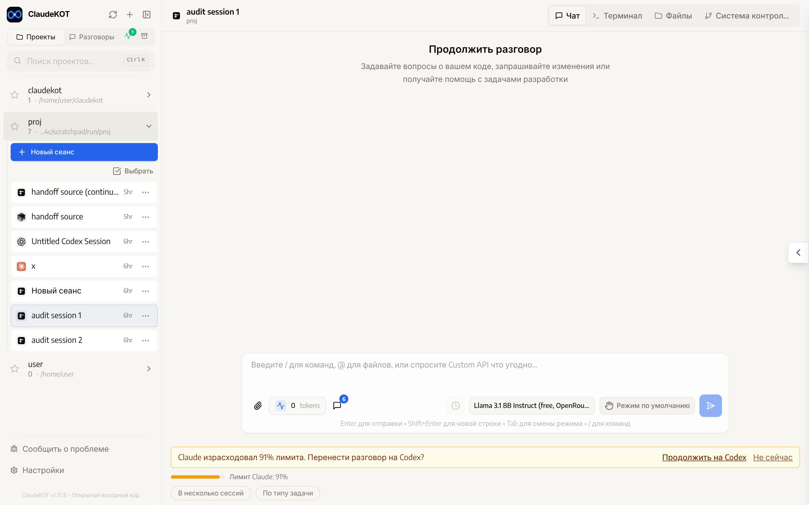
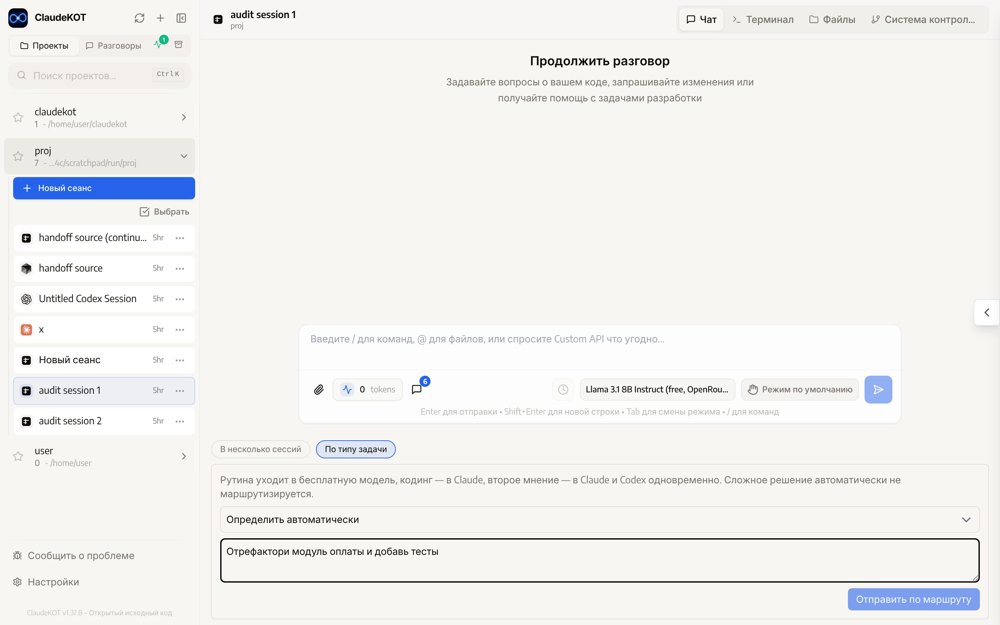

<div align="center">
 
 <h1>ClaudeKOT</h1>
 <p>One web interface for several AI coding agents that work on the same project and take over from each other:<br><b>Claude Code · Codex · Cursor · OpenCode · any API service (OpenRouter, Anthropic, OpenAI)</b></p>
</div>

<div align="right"><i><b>English</b> · <a href="docs/README.ru.md">Русский</a></i></div>

> A personal project, built on the open-source [siteboon/claudecodeui](https://github.com/siteboon/claudecodeui) (CloudCLI). Everything the original does (chat, terminal, files, git, plugins) is still here. This page covers only what was added.

---

## Why

Every agent has its own strengths and its own limits. ClaudeKOT keeps them in one project so you do not have to think about which one is available right now:

- **A limit runs out, the work goes on.** When Claude hits its subscription limit, the conversation moves — with its full history — to the next backend (Codex, for example), which picks up where Claude stopped.
- **A warning ahead of time.** Once Claude or Codex has used 80–95% of its limit (you choose the threshold), the chat offers to move the conversation with one click after the current reply.
- **The right agent for the task.** Routine work goes to a free model, code to Claude Code, a "second opinion" to Claude and Codex at once.
- **One plan, several workers.** A lead agent splits a task into subtasks and each goes to the backend with the matching role.

<div align="center">

<br><em>Claude has used 91% of its limit — an offer to continue on Codex (interface shown in Russian; English is built in)</em>
<br><br>

<br><em>Sending a task by type: routine, code, second opinion</em>
</div>

## What is added to the original

| Feature | What it does |
|---|---|
| **Custom API** — a new backend | Chat with any model by API key: OpenRouter, Anthropic, OpenAI. The service is chosen together with the model; OpenRouter's free models are read from its current list. |
| **Handoff on a limit** | The conversation moves to a fallback backend on its own when the current one refuses a request over a limit. The fallback order is configurable. |
| **Offer at a threshold** | A usage indicator in the chat and a "Continue on …" button once the threshold is reached (80/85/90/95%, or off). Works for Claude and Codex. |
| **Several sessions at once** | One message sent to several sessions on different backends. |
| **By task type** | Routing by plain rules from `task-router.config.json` (keywords you edit by hand, no AI classifier). |
| **Orchestrator** | The backend with the "orchestrator" role plans a task and coordinates it: subtasks go to the "hands" and "routine" backends as separate sessions — read-only ones side by side, editing ones one at a time — their results come back, and the orchestrator closes the task or sends follow-ups (up to 4 rounds). |
| **Backend roles** | In settings: who leads, who executes, who takes routine work. |
| **Shared skills** | One set of skills visible to both Claude and Codex. |
| **Russian interface** | Every new element is translated; the app follows your browser language. |

### What is deliberately left alone

- Sign-in and token storage for Claude Code and Codex (`~/.claude`, `~/.codex`) — as in the original.
- Running the CLIs as subprocesses — as in the original.
- **No shared API layer on top of subscriptions.** Each backend talks only to its own provider with its own credentials. Custom API keys are separate environment variables and have nothing to do with the subscriptions.

## Running it on your own computer

You need [Node.js 22+](https://nodejs.org/) and [Git](https://git-scm.com/downloads). The agents you want to use (Claude Code, Codex) must be installed and signed in as usual.

In a terminal (PowerShell on Windows), run one after another:

```bash
git clone https://github.com/Kosqip/ClaudeKOT.git
```

```bash
cd ClaudeKOT
```

```bash
npm install
```

```bash
npm start
```

The first build takes a couple of minutes. When the address appears, open **http://localhost:3001** in a browser, create a local account (it is stored only on your machine) and pick a project folder.

Stop with `Ctrl+C`. To update: `git pull`, then `npm install` and `npm start` again.

### Keys for Custom API (optional)

Copy `.env.example` to `.env` and fill in the keys for the services you use:

```
OPENROUTER_API_KEY=sk-or-...
ANTHROPIC_DIRECT_API_KEY=sk-ant-...
OPENAI_DIRECT_API_KEY=sk-...
```

Restart `npm start` after changing `.env`.

### Where things are configured

- **Settings → Agents**: handoff threshold, fallback order, backend roles, skills.
- **Below the chat input**: "Several sessions", "By task type", "Orchestrator".
- **`task-router.config.json`** in the repository root: keywords for routing by task type.

## Status

Everything listed is implemented and covered by automated tests (over 2,200 checks). Not all of it has been exercised against real subscriptions and keys yet; the list of decisions, defects found and what is still to verify is kept in [docs/PROJECT_REQUIREMENTS.md](docs/PROJECT_REQUIREMENTS.md) (in Russian).

## License and credits

[GNU AGPL v3.0 or later](LICENSE), same as the original.

Built on [CloudCLI / claudecodeui](https://github.com/siteboon/claudecodeui) by Siteboon. Ideas on limit detection and handing work between agents were borrowed from [razzant/claudexor](https://github.com/razzant/claudexor) (no code copied).
