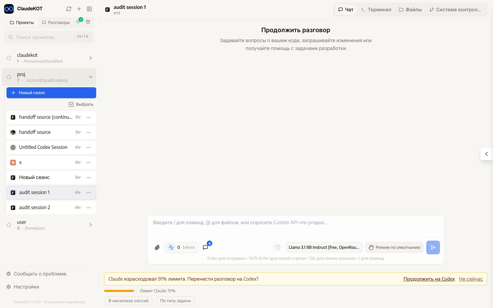
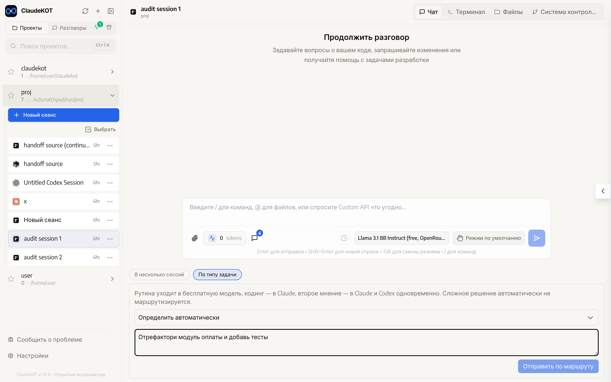

<div align="center">
 
 <h1>ClaudeKOT</h1>
 <p>Один веб-интерфейс для нескольких ИИ-агентов, которые работают над одним проектом и подменяют друг друга:<br><b>Claude Code · Codex · Cursor · OpenCode · любой API-сервис (OpenRouter, Anthropic, OpenAI)</b></p>
</div>

<div align="right"><i><a href="../README.md">English</a> · <b>Русский</b></i></div>

> Личный проект. Сделан на основе открытого [siteboon/claudecodeui](https://github.com/siteboon/claudecodeui) (CloudCLI) — всё, что умеет оригинал (чат, терминал, файлы, git, плагины), здесь сохранено. Ниже описано только то, что добавлено.

---

## Зачем это

У каждого агента свои сильные стороны и свои лимиты. ClaudeKOT позволяет держать их в одном проекте и не думать, кто сейчас «в строю»:

- **Закончился лимит — работа продолжается.** Claude упёрся в лимит подписки — разговор со всей историей сам переезжает на следующий бэкенд (например, Codex), и тот продолжает с того же места.
- **Предупреждение заранее.** Когда лимит Claude или Codex израсходован на 80–95% (порог выбираете сами), после очередного ответа появляется предложение перенести разговор одной кнопкой.
- **Задача — нужному исполнителю.** Рутина уходит в бесплатную модель, код — в Claude Code, «второе мнение» — одновременно в Claude и Codex.
- **Один план — несколько исполнителей.** Главный агент разбивает задачу на подзадачи, и каждая уходит бэкенду с подходящей ролью.

<div align="center">

<br><em>Claude израсходовал 91% лимита — предложение продолжить на Codex</em>
<br><br>

<br><em>Отправка задачи по типу: рутина, код, второе мнение</em>
</div>

## Что добавлено к оригиналу

| Возможность | Что делает |
|---|---|
| **Custom API** — новый бэкенд | Чат с любой моделью по API-ключу: OpenRouter, Anthropic, OpenAI. Сервис выбирается вместе с моделью; бесплатные модели OpenRouter берутся из его актуального списка. |
| **Эстафета при лимите** | Автоматический перенос разговора на запасной бэкенд, когда текущий отказал из-за лимита. Порядок запасных настраивается. |
| **Предложение переноса по порогу** | Индикатор расхода лимита в чате и кнопка «Продолжить на …» при достижении порога (80/85/90/95% или выключено). |
| **В несколько сессий** | Одно сообщение — сразу в несколько сессий разных бэкендов. |
| **По типу задачи** | Маршрутизация по простым правилам из `task-router.config.json` (ключевые слова правятся руками, без ИИ-классификатора). |
| **Разбить на подзадачи** | Бэкенд с ролью «оркестратор» составляет план, подзадачи открываются отдельными сессиями у «рук» и «рутины». |
| **Роли бэкендов** | В настройках: кто главный, кто исполнитель, кто для рутины. |
| **Skills для всех** | Один набор skills виден и Claude, и Codex. |
| **Русский интерфейс** | Все новые элементы переведены; язык выбирается по языку браузера. |

### Что принципиально не тронуто

- Авторизация и хранение токенов Claude Code и Codex (`~/.claude`, `~/.codex`) — как в оригинале.
- Запуск CLI как подпроцессов — как в оригинале.
- **Нет общего API-слоя поверх подписок.** Каждый бэкенд обращается только к своему провайдеру, своими учётными данными. Ключи Custom API — отдельные переменные окружения и с подписками никак не связаны.

## Запуск на своём компьютере (Windows, без VPS)

Нужны: [Node.js 22+](https://nodejs.org/) и [Git](https://git-scm.com/download/win). Агенты, которыми хотите пользоваться (Claude Code, Codex), должны быть установлены и авторизованы как обычно.

Откройте PowerShell и выполните по очереди:

```bash
git clone https://github.com/Kosqip/ClaudeKOT.git
```

```bash
cd ClaudeKOT
```

```bash
npm install
```

```bash
npm start
```

Первая сборка занимает пару минут. Когда в окне появится адрес, откройте в браузере **http://localhost:3001**, создайте локальную учётную запись (она хранится только на вашем компьютере) и выберите папку проекта.

Чтобы остановить — `Ctrl+C` в окне PowerShell. Чтобы обновиться — `git pull`, затем снова `npm install` и `npm start`.

### Ключи для Custom API (необязательно)

Скопируйте `.env.example` в `.env` и впишите ключи тех сервисов, которыми пользуетесь:

```
OPENROUTER_API_KEY=sk-or-...
ANTHROPIC_DIRECT_API_KEY=sk-ant-...
OPENAI_DIRECT_API_KEY=sk-...
```

После изменения `.env` перезапустите `npm start`.

### Где что настраивается

- **Настройки → Агенты**: порог предложения переноса, порядок запасных бэкендов, роли бэкендов, skills.
- **Под полем ввода в чате**: кнопки «В несколько сессий», «По типу задачи», «Разбить на подзадачи».
- **`task-router.config.json`** в корне: ключевые слова для маршрутизации по типу задачи.

## Состояние проекта

Всё перечисленное реализовано и покрыто автотестами (более 2200 проверок). Вживую с настоящими подписками и ключами проверено ещё не всё — подробный список решений, найденных ошибок и того, что осталось проверить, ведётся в [docs/PROJECT_REQUIREMENTS.md](PROJECT_REQUIREMENTS.md).

## Лицензия и благодарности

[GNU AGPL v3.0 или новее](../LICENSE), как и у оригинала.

Основа — [CloudCLI / claudecodeui](https://github.com/siteboon/claudecodeui) от Siteboon. Идеи по распознаванию лимитов и передаче работы между агентами подсмотрены у [razzant/claudexor](https://github.com/razzant/claudexor) (код не копировался).
